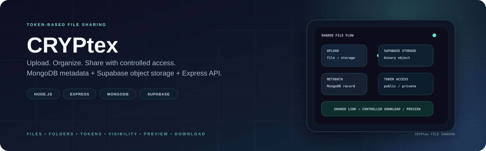
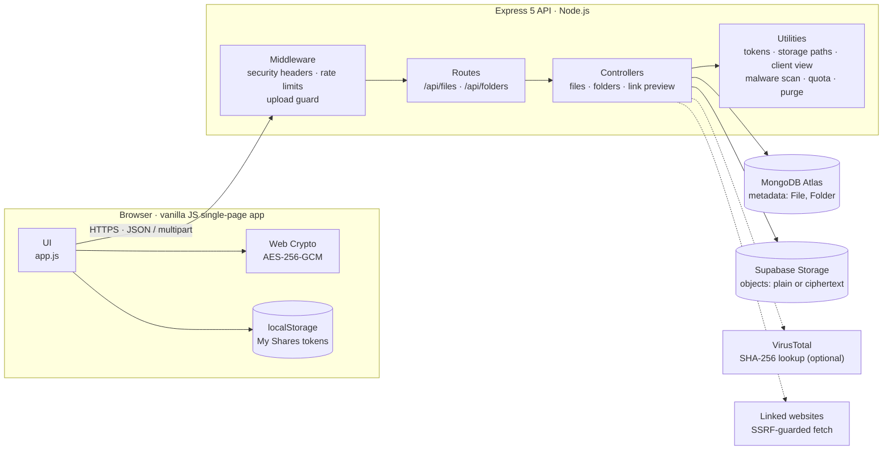
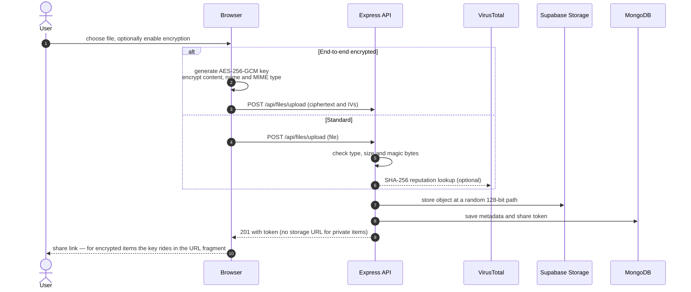

<p align="center">
  
</p>

<h1 align="center">Cryptex</h1>

<p align="center">
  <b>Token-based file sharing with optional end-to-end encryption.</b><br>
  Upload, organize and share files with short access tokens — and lock anything in the browser before it ever leaves your device.
</p>

<p align="center">
  <a href="https://cryptex-file-sharing.onrender.com/"></a>
  <a href="https://github.com/Zephyrex21/cryptex-file-sharing/actions/workflows/ci.yml"></a>
  
  
  
  
  
</p>

<p align="center">
  <a href="https://cryptex-file-sharing.onrender.com/"><b>Live demo</b></a> ·
  <a href="#architecture">Architecture</a> ·
  <a href="#security-model">Security model</a> ·
  <a href="#getting-started">Getting started</a> ·
  <a href="#api-reference">API</a>
</p>

---

## Contents

- [Overview](#overview)
- [Features](#features)
- [Architecture](#architecture)
- [Security model](#security-model)
- [Tech stack](#tech-stack)
- [Getting started](#getting-started)
- [Configuration](#configuration)
- [API reference](#api-reference)
- [Testing and quality](#testing-and-quality)
- [Deployment and operations](#deployment-and-operations)
- [Known limitations and roadmap](#known-limitations-and-roadmap)
- [License](#license)

## Overview

Cryptex is a full-stack file-sharing app built around **short share tokens** instead of user accounts. Anyone can drop a file or a link in, put it in a folder, and share it publicly or privately; a private item is reachable only with its token. For sensitive material, an upload can be **end-to-end encrypted in the browser** (AES-256-GCM): the server then stores only ciphertext and never receives the key.

Metadata lives in **MongoDB**, file bytes live in **Supabase Storage**, and an **Express 5** API enforces access control, validation and abuse limits in between. The frontend is a dependency-free vanilla JavaScript single-page app served by the same server.

## Features

**Sharing**
- Files, links (with title/description/preview image) and folders, each with a 6-character share token (`[0-9a-z]`, for example `k3x9a2`).
- Public or private visibility, switchable at any time. Private items are invisible in listings and reachable only by token.
- Per-token controls: expiry, view limits, and one-click regeneration to rotate a leaked token.
- **My Shares**: a local-only (browser `localStorage`) list of the private items you created, so you never have to remember a token. It never stores decryption keys or real names of encrypted items.

**End-to-end encryption**
- Opt-in per upload. Content, filename and MIME type are all encrypted client-side with the Web Crypto API (AES-256-GCM, fresh random IV for every field).
- The key travels only in the link's URL fragment (`#key=…`), which browsers never send to a server.
- **Encrypted vaults**: a folder whose files all share one browser-generated key, unlocked by a single link.

**Files and folders**
- 50 MB per file; images, video, PDF, Office documents, ZIP archives, plain text/CSV and source code. Plain uploads are verified by magic-byte signature, not just by the declared type.
- Inline preview for images, video and PDF; everything else downloads.
- Rename, delete, move between folders, download a folder or a selection as a ZIP.

**Built-in protections**
- Per-IP rate limits, upload concurrency and size guards, optional global storage cap, optional VirusTotal known-hash screening, SSRF-safe link previews. Details in [Security model](#security-model).

## Architecture

### System overview



**Design principles**

| Principle | How it shows up |
|---|---|
| **Separate metadata from bytes** | MongoDB holds records, tokens and relationships; Supabase holds the objects. Neither alone is enough to reconstruct a private file. |
| **The token is the permission** | There are no accounts. A private item's current, unexpired token authorizes access; public items are open by design (a "drop box" model). |
| **Don't trust the server with secrets** | Encryption keys are generated and used in the browser and never appear in a request, response, log or database row. |
| **Thin controllers, shared rules** | Access rules live in one module (`middleware/auth.js`), so every route applies them identically. |
| **Fail closed on privacy actions** | If a storage operation required for a privacy change fails, the change is rejected rather than reported as done. |

### Upload flow



### Access control

| Item | Read (view, download) | Change (rename, visibility, delete, move) |
|---|---|---|
| Public file or folder | Anyone | Anyone (drop-box model) |
| Private file | Valid, unexpired token | Valid, unexpired token¹ |
| Encrypted file | Ciphertext and encrypted metadata by id (unusable without the key) | Valid, unexpired token¹ |
| Private folder or vault | Valid, unexpired token | Valid, unexpired token¹; uploads into a vault need the vault's token |

¹ Deleting also works with an *expired* token (it must still be the current one), so expiry can never strand data.

### Data model

| `File` | `Folder` |
|---|---|
| `originalName`, `fileType`, `fileSize` | `name` |
| `itemType` (`file` or `link`) and `link*` fields | `files[]` (references) |
| `filePath`, `fileUrl` (hidden from clients when private) | `visibility` (`public` or `private`) |
| `visibility`, `shareToken`, `tokenExpiresAt`, `maxViews`, `viewCount` | `shareToken`, `tokenExpiresAt`, `maxViews`, `viewCount` |
| `encrypted`, `encryptionIV`, `encryptedName*`, `encryptedMimeType*` | `encrypted` (vault flag) |
| `folderId`, timestamps | timestamps |

`shareToken` carries a unique, sparse index on both collections.

### Project structure

```text
.
├── index.js                  # App bootstrap: headers, CORS, routers, error handling, optional purge job
├── config/                   # MongoDB connection, Supabase client
├── routes/                   # Route tables and per-route rate limiters
├── controllers/
│   ├── fileUpload.js         # Upload, access, preview/download, visibility, links, ZIP
│   ├── folderController.js   # Folder CRUD, membership, folder ZIP
│   └── linkPreview.js        # SSRF-guarded fetching and HTML/image parsing for link items
├── middleware/
│   ├── auth.js               # Token / visibility access rules (single source of truth)
│   └── uploadGuard.js        # Concurrency and declared-size limits for uploads
├── models/                   # Mongoose schemas: File, Folder
├── utils/                    # Tokens, storage paths, client-safe views, malware scan,
│                             # storage quota, expired-file purge, error helper, token retry
├── public/                   # Static frontend: landing page, app, CSS, vanilla JS
├── scripts/                  # One-off maintenance (re-key private storage objects)
├── tests/                    # Vitest unit and integration-style tests
├── e2e/                      # jsdom end-to-end suite that drives the real frontend
├── openapi.json              # OpenAPI spec, served at /api-docs
└── .github/workflows/ci.yml  # Lint, unit tests, e2e, dependency audit
```

## Security model

**Encryption**
- AES-256-GCM via the Web Crypto API; keys are generated in the browser. Content, filename and MIME type are each encrypted with their own random IV.
- Encrypted files are always private and cannot be renamed or made public (the name is ciphertext).
- A lost share link means an unrecoverable file: there is nothing on the server that could rebuild the key.
- **Honest threat model:** as with any browser-based encryption tool, your browser runs JavaScript delivered by the server, so you trust the operator not to serve modified code. The source is public; you can host your own copy.

**Access control and storage**
- A private item is reachable only with its current, unexpired token, enforced server-side on every route. Rotating a token invalidates the old one immediately.
- Storage objects use unguessable 128-bit random paths. `fileUrl` and `filePath` are never returned to clients for private items; their bytes flow through the token-checked `/preview` and `/download` routes.
- When a file goes public → private, or its token is regenerated, the object is moved to a fresh random path so any previously seen URL stops working. If that move fails, the action fails.
- Deletes remove the database record first and the storage object afterwards, so a failure can never leave a record pointing at missing bytes.

**Input handling**
- Plain uploads are checked against an allow-list and verified by magic-byte signature; request fields reaching database queries must be plain strings (no operator injection).
- Only images, video and PDF render inline; every other type is forced to download with `Content-Security-Policy: sandbox`, so uploaded HTML or SVG cannot run on the app's origin.
- Optional VirusTotal screening compares an upload's SHA-256 against known malware. It is a known-hash reputation check only: it cannot catch a new file and may be rate-limited on a free key.

**Link previews (SSRF defence)**
- Every URL and every redirect hop is resolved and rejected if it points at private, loopback, link-local, reserved or otherwise internal addresses (IPv4 and every IPv6 notation, including mapped and NAT64 forms).
- One deadline covers headers and body; responses are size-capped; preview images are verified from their bytes and mirrored into your own storage, so visitors' browsers never contact third-party sites.
- Parsing uses a bounded, linear-time scanner (no backtracking regexes).

**Abuse resistance**

| Control | Default |
|---|---|
| Failed token attempts (per IP, per router) | 30 / minute |
| File reads / uploads / ZIP downloads / link creation (per IP) | 60 / 20 / 10 / 10 per minute |
| Concurrent uploads (global) | 4 (`MAX_CONCURRENT_UPLOADS`); beyond that `503` with `Retry-After` |
| Declared upload size | `413` before the body is read |
| Total storage | Optional cap via `MAX_TOTAL_STORAGE_MB` (`507` when full) |

**Hardening**
- Security headers: `X-Content-Type-Options`, `X-Frame-Options`, `Referrer-Policy: no-referrer`, HSTS, and a CSP pinning `frame-ancestors`, `object-src`, `base-uri` and `form-action`. `X-Powered-By` is disabled.
- Unexpected errors return a generic message (details go to the server log); malformed ids and JSON return `400`.
- Share-token collisions are retried transparently; the CI pipeline audits production dependencies.

## Tech stack

| Layer | Technology |
|---|---|
| Runtime and API | Node.js 20+, Express 5, `express-rate-limit`, Multer 2 |
| Database | MongoDB Atlas via Mongoose (multi-document transactions) |
| Object storage | Supabase Storage |
| Frontend | Vanilla JavaScript, HTML and CSS; Web Crypto API; bundled `qrcode` library for QR codes (generated in the browser) |
| Archives | `archiver` (streamed ZIP downloads) |
| Quality | Vitest, ESLint, jsdom end-to-end suite, GitHub Actions |
| API docs | OpenAPI 3 via Swagger UI at `/api-docs` |

## Getting started

### Prerequisites

- **Node.js 20 or newer**
- A **MongoDB Atlas** cluster (or any replica-set deployment: the app uses transactions)
- A **Supabase** project with a Storage bucket. Create the bucket as **public**: public items are served by their storage URL, while private items are protected by random object paths and server-side access checks.

### Run locally

```bash
git clone https://github.com/Zephyrex21/cryptex-file-sharing.git
cd cryptex-file-sharing
npm install
cp .env.example .env        # then fill in the values below
npm run dev                 # nodemon, http://localhost:3000
```

For production use `npm start`.

## Configuration

Set these in `.env` (see [`.env.example`](.env.example)).

| Variable | Required | Default | Purpose |
|---|---|---|---|
| `MONGO_URI` | yes | n/a | MongoDB connection string |
| `SUPABASE_URL` | yes | n/a | Supabase project URL |
| `SUPABASE_SERVICE_KEY` | yes | n/a | Supabase service-role key (server only, never exposed to clients) |
| `SUPABASE_BUCKET` | no | `cloudvault-files` | Storage bucket name |
| `PORT` | no | `3000` | HTTP port |
| `TRUST_PROXY` | recommended in production | unset | Number of reverse proxies in front of the app (`1` on Render and most PaaS). Without it, all visitors share one IP for rate limiting |
| `ALLOWED_ORIGIN` | no | unset | Enables CORS for one specific origin; the bundled frontend needs none |
| `VIRUSTOTAL_API_KEY` | no | unset | Enables known-hash malware screening |
| `VIRUSTOTAL_FAIL_CLOSED` | no | `false` | `true` rejects uploads when VirusTotal can't give a verdict |
| `MAX_CONCURRENT_UPLOADS` | no | `4` | Global cap on simultaneous uploads (each is buffered in memory) |
| `MAX_TOTAL_STORAGE_MB` | no | off | Global storage ceiling, e.g. `800` on a 1 GB plan |
| `PURGE_EXPIRED_AFTER_DAYS` | no | off | Delete private files whose token expired this many days ago |
| `GALLERY_MAX_ITEMS` | no | `1000` | Cap for unpaged gallery responses |
| `DISABLE_API_DOCS` | no | `false` | `true` stops serving Swagger UI at `/api-docs` |

## API reference

Interactive documentation is served at **`/api-docs`** (Swagger UI, generated from [`openapi.json`](openapi.json)).

**Authorization:** *Public* items need no token. For *private* items, send the item's current token as `?token=` or an `X-Share-Token` header. To remove a private file from a folder, the file's own token goes in `?fileToken=` (`X-File-Token`) because `?token=` carries the folder's. Moving a file out of a private folder also needs `?sourceToken=` (`X-Source-Token`).

### Files

| Method | Endpoint | Description | Access |
|---|---|---|---|
| `POST` | `/api/files/upload` | Upload a file (optionally encrypted; see below) | Open |
| `POST` | `/api/files/link` | Save a link with a generated preview | Open |
| `GET` | `/api/files` | List public files (`?page=&limit=` for paging) | Open |
| `GET` | `/api/files/token/:token` | Open an item by its token | Token |
| `GET` | `/api/files/:id` | File details | Public or token |
| `GET` | `/api/files/:id/preview` | Inline preview (images, video, PDF) | Public or token |
| `GET` | `/api/files/:id/download` | Download | Public or token |
| `PATCH` | `/api/files/:id` | Rename | Public or token |
| `PATCH` | `/api/files/:id/visibility` | Visibility, expiry, view limit, token rotation | Public or token |
| `DELETE` | `/api/files/:id` | Delete | Public or token |
| `POST` | `/api/files/batch-zip` | ZIP of selected public files | Open |

### Folders

| Method | Endpoint | Description | Access |
|---|---|---|---|
| `POST` | `/api/folders` | Create a folder or encrypted vault | Open |
| `GET` | `/api/folders` | List public folders | Open |
| `GET` | `/api/folders/token/:token` | Open a folder by its token | Token |
| `GET` | `/api/folders/:id` | Folder with its files | Public or token |
| `GET` | `/api/folders/:id/zip` | Download as ZIP | Public or token |
| `PATCH` | `/api/folders/:id` | Rename | Public or token |
| `PATCH` | `/api/folders/:id/visibility` | Visibility, expiry, view limit, token rotation | Public or token |
| `DELETE` | `/api/folders/:id` | Delete (files are unlinked, not deleted) | Public or token |
| `POST` | `/api/folders/:id/files` | Add a file to the folder | Folder and file access |
| `DELETE` | `/api/folders/:id/files/:fileId` | Remove a file from the folder | Folder and file access |

**Encrypted uploads** send `file` as ciphertext (`application/octet-stream`) plus the multipart fields `encrypted=true`, `iv`, `encryptedName`, `encryptedNameIV`, `encryptedMimeType` and `encryptedMimeTypeIV`. To upload into a vault, also send `vaultFolderId` and that vault's token (`?token=`).

## Testing and quality

```bash
npm run lint                      # ESLint
npm test                          # 311 unit and integration-style tests (Vitest)
cd e2e && npm ci && npm test      # 80 end-to-end checks against the real frontend (jsdom)
```

- Unit tests cover access rules, token handling, magic-byte verification, the SSRF guard, rate limiting, vault and encryption rules, storage rotation and error handling. Some suites run the real Mongoose schemas without a database to pin down indexes, enums and defaults.
- The e2e suite loads the actual `public/js/app.js` in jsdom against a fake API built on the server's real auth code, and exercises uploads, sharing, vaults, key handling and UI flows.
- **CI** (GitHub Actions) runs lint and unit tests, the e2e suite, and `npm audit --omit=dev --audit-level=high` on every push and pull request.
- Real MongoDB behavior (transactions, index enforcement) is not covered by the automated suite; see [TESTING.md](TESTING.md) for scope and details.

## Deployment and operations

The app runs on any Node host; the live demo is deployed on Render.

- **Build:** `npm install` · **Start:** `npm start`
- Set the required environment variables, and set **`TRUST_PROXY=1`** behind Render or a similar proxy.
- **Re-keying existing private files:** `node scripts/rotate-private-storage.js --dry-run`, then without `--dry-run`. Moves objects that were private before random paths existed to fresh random paths.
- **Housekeeping:** `PURGE_EXPIRED_AFTER_DAYS` enables a background job that deletes long-expired private files. `MAX_TOTAL_STORAGE_MB` protects a free-tier quota.

## Known limitations and roadmap

**Limitations (by design or not yet addressed)**
- **No accounts.** A private item's token grants full control (view, rename, delete, change visibility, rotate the token), and public items can be modified by anyone.
- **Web-delivered encryption** requires trusting the server's JavaScript (see [Security model](#security-model)).
- Encryption happens at upload time only; existing plain files can't be encrypted in place or added to a vault afterwards.
- Encrypted files are excluded from ZIP downloads.
- The storage bucket is public; privacy of private objects rests on unguessable paths and server mediation rather than signed URLs.
- Link-preview DNS validation and the actual connection resolve separately, leaving a narrow DNS-rebinding window.

**Roadmap**
- Separate read-only *view* tokens from *manage* tokens.
- Private bucket with short-lived signed URLs.
- Pin validated IPs for link-preview connections.
- Bind ciphertext to its metadata (AES-GCM additional data) with a versioned format.
- Dockerfile and containerized CI build.

## License

Released under the **ISC License**.

<p align="center">
  Maintained by <a href="https://github.com/Zephyrex21">@Zephyrex21</a>
</p>
